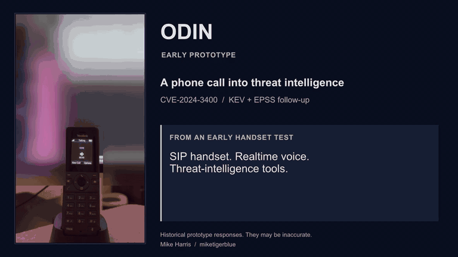
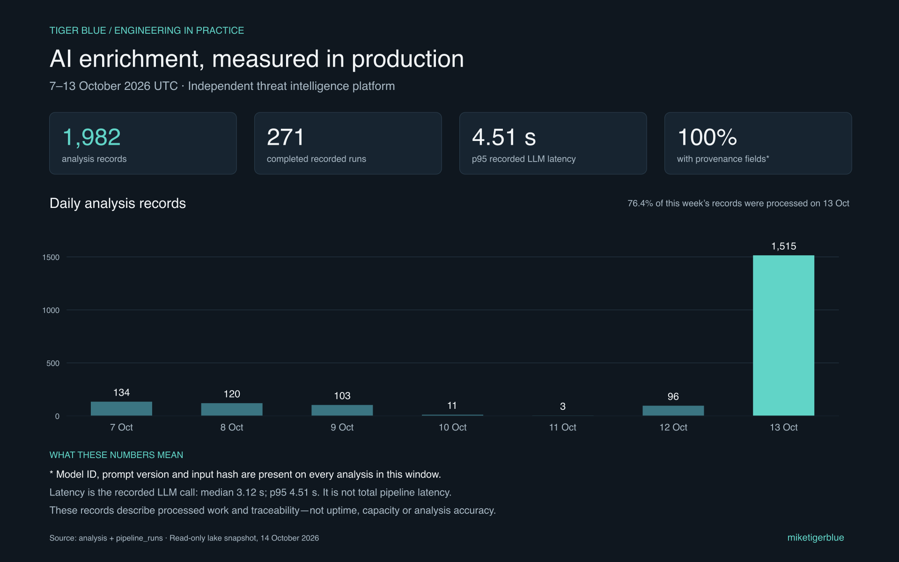

# Mike Harris · miketigerblue

Engineering leader and former CTO working across **Linux, networks, edge infrastructure and device trust**. My career spans Bermuda's early internet, carrier networks and certificate-authority infrastructure, through to secure connectivity for rail fleets at Motion Applied.

Alongside that work, I build an independent threat intelligence platform and practical AI integrations. The public projects below cover ingestion, structured enrichment, a SIP voice interface and a Proton Mail Bridge MCP server. The case studies show the decisions, operational problems and measurements behind the threat intelligence platform.

[LinkedIn](https://www.linkedin.com/in/tigerblue) · [Email](mailto:mike@tigerblue.tech)

> These are independent projects built outside my employment. They do not represent the systems of any current or former employer.

## ODIN — early prototype demo

A one-minute excerpt from an early handset test of my independent threat-intelligence voice interface. **Early prototype:** historical responses, retained as an engineering demonstration.

The captioned preview is silent. **[Video with audio (MP4)](https://github.com/miketigerblue/miketigerblue/raw/refs/heads/main/media/odin-early-prototype.mp4)** · [Transcript and prototype context](evidence/odin-early-prototype.md) · [ODIN code and runbook](https://github.com/miketigerblue/asterisk-twilio-pbx)

## Proton Mail Bridge MCP

**Email tools for Claude and other MCP clients.** A Python MCP server for searching, reading, drafting and organising email through Proton Mail Bridge.

The connection to Bridge uses local IMAP/SMTP, with certificate pinning, macOS Keychain credentials and pooled connections. The project includes installation guidance, troubleshooting and a documented threat model.

Community interest: **[8 stars](https://github.com/miketigerblue/proton-bridge-mcp/stargazers)** · **[4 forks](https://github.com/miketigerblue/proton-bridge-mcp/forks)**, as of 17 October 2026.

[**Repository and setup**](https://github.com/miketigerblue/proton-bridge-mcp) · [Threat model](https://github.com/miketigerblue/proton-bridge-mcp#threat-model)

## Engineering case studies

| Case study | What it demonstrates |
|---|---|
| **[Migrating a threat intelligence lake without losing its history](evidence/2026-05-lake-migration.md)** | Archive and restore design, compatibility problems, data-quality fixes, and honest handling of missing historical metadata. Migration: May 2026. |
| **[AI enrichment, measured in production](evidence/2026-10-07-13-enrichment.md)** | A dated processing snapshot with workload distribution, LLM-call latency and provenance-field coverage. Observation: 7–13 October 2026 UTC. |

## Evidence from production

A measured week from my independent platform: **1,982 analysis records across 271 completed recorded runs**, with model ID, prompt version and input hash present on every analysis in the window.

[Measurement definitions and case study](evidence/2026-10-07-13-enrichment.md) · [Aggregate data](evidence/2026-10-07-13-enrichment.json)

The figures describe recorded work and metadata. LLM-call latency is separate from end-to-end delivery; the snapshot does not establish uptime, maximum capacity or analysis accuracy.

## Public projects

| Project | Engineering focus | Read further |
|---|---|---|
| [**Tiger2Go**](https://github.com/miketigerblue/tiger2go) | Go ingestion service: concurrent workers, retries, normalisation, PostgreSQL migrations and operational metrics. | [System design](https://github.com/miketigerblue/tiger2go/blob/main/docs/SYSTEM_DESIGN.md) |
| [**Tiger-Eye**](https://github.com/miketigerblue/tiger-eye) | Python enrichment service: structured analysis, pgvector retrieval, bounded concurrency and execution metadata. | [Architecture and failure modes](https://github.com/miketigerblue/tiger-eye/blob/main/SYSTEM_DESIGN.md) |
| [**ODIN**](https://github.com/miketigerblue/asterisk-twilio-pbx) | Asterisk/SIP and a streaming voice bridge: audio pacing, interruptions, backpressure and tool-backed intelligence retrieval. | [Operational runbook](https://github.com/miketigerblue/asterisk-twilio-pbx/blob/main/RUNBOOK.md) |
| [**Proton Mail Bridge MCP**](https://github.com/miketigerblue/proton-bridge-mcp) | Python MCP server: local IMAP/SMTP integration, certificate pinning, Keychain credentials and pooled connections. | [Setup and threat model](https://github.com/miketigerblue/proton-bridge-mcp#threat-model) |

### How the platform evolved

The original platform used a Rust ingestor and a Fly.io-hosted lake, with L1 analysis and Python-based Number 2 reporting. In May 2026 I archived that lake and restored its threat intelligence data into a separate `legacy` schema alongside the newer Go-based Tiger2Go and Python Tiger-Eye stack. The migration record identifies T2 as the Go successor to Number 2.

That history matters when reading older diagrams and reports. The [migration case study](evidence/2026-05-lake-migration.md) distinguishes the old and new systems, and the repository documentation describes each public component. ODIN's documented Raspberry Pi/Fly.io voice deployment is separate from the retired Fly.io database.

[Historical ODIN report: 26 February–4 March 2026](ODIN-TLR-26-Feb--04-Mar-2026.pdf)

## Career Background

My career began in the early internet era.

I started in **BerMUG** in the late 1980s running a FirstClass BBS federated with global Mac communities.

In 1994 I helped build Bermuda's first commercial ISP, **Internet Bermuda Ltd**, serving as .BM TLD hostmaster and deploying one of the island's first secure online credit-card systems.

Later I became CTO of **Quantum Communications**, launching Bermuda's first metro-Ethernet service, CLEC interconnection, and a national IP/MPLS backbone.

My telecom background also includes work with **Cable & Wireless** and **Logic**, extending that experience across Bermuda's carrier and connectivity landscape.

At **QuoVadis** I designed and delivered a Tier III data centre supporting PKI certificate-authority infrastructure including HSM-backed systems.

I later founded **OnXis**, a security consultancy delivering incident response, digital forensics, and resilience engineering for governments and enterprises.

More recently I worked at **deltaflare**, building DevSecOps pipelines and hardened Linux systems for industrial IoT platforms.

Today I work at **Motion Applied**, engineering secure rail connectivity systems and supporting compliance work across ISO 27001, ISO 9001, ISO 14001, NIS2, and IEC 62443 environments.

Technical background and tools

## Tech Stack

### Languages

### AI / Machine Learning

### Networking & Carrier

### PKI & Cryptography

### Voice & Comms

### Infrastructure & Data

### Security & Intelligence

### Compliance & Audit

## Get in Touch

- **LinkedIn:** [linkedin.com/in/tigerblue](https://www.linkedin.com/in/tigerblue)
- **X:** [@LoveFlowState](https://x.com/loveflowstate)
- **Email:** mike@tigerblue.tech
